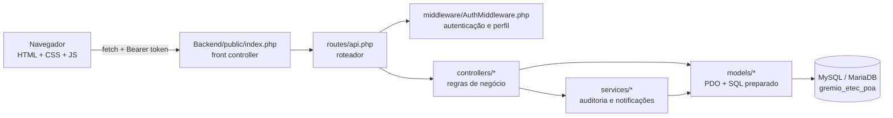

# Visão geral da arquitetura

## Resumo

Aplicação web em **PHP puro** com arquitetura **MVC simplificada**. O frontend (páginas `.php` + JavaScript puro) conversa com uma **API REST em JSON** por `fetch`. Não há framework, gerenciador de pacotes nem etapa de *build*.

## Caminho de uma requisição

1. O JavaScript (`js/api.js`) monta a URL da API a partir do endereço da página (`<pasta>/Backend/public/api/...`), de modo que o projeto funciona em qualquer subpasta do Wamp.
2. O Apache aplica `Backend/public/.htaccess`: preserva o cabeçalho `Authorization` e manda tudo que não for arquivo real para `Backend/public/index.php`.
3. `index.php` responde ao *preflight* CORS, normaliza a URI e chama a função de rotas.
4. `routes/api.php` compara método + caminho, autentica (`autenticarRequisicao()`), checa o perfil (`exigirPerfil([...])`) e instancia o controller.
5. O **controller** valida a entrada, aplica as regras e chama o **model**.
6. O **model** executa SQL via PDO com *prepared statements* e devolve arrays associativos.
7. O controller responde JSON `{ "success": true|false, "message": "...", ... }` com o código HTTP adequado.

## Pastas do backend

| Pasta | Responsabilidade |
|---|---|
| `Backend/public/` | Único ponto de entrada web da API |
| `Backend/routes/` | `api.php`: tabela de rotas |
| `Backend/controllers/` | Um controller por módulo (`Evento`, `Votacao`, `Projeto`, `Financeiro`, `Orcamento`, `Auditoria`, `Conta`, `Resumo`, ...) |
| `Backend/models/` | Acesso ao banco por módulo (`Usuario`, `Sessao`, `Evento`, ...) |
| `Backend/middleware/` | `AuthMiddleware.php`: leitura do token, sessão válida, `exigirPerfil` |
| `Backend/services/` | `AuditoriaService` (registra logs) e `NotificacaoService` (gera notificações) |
| `Backend/config/` | `database.php` (conexão), `env.php` (leitura do `.env`), `app.php` (opções da aplicação) |
| `Backend/tests/` | Scripts de manutenção executados **pelo terminal** (criar admin, diagnóstico, proteção do admin). Não são testes automatizados |

## Configuração por ambiente

`Backend/config/env.php` lê, nesta ordem: variável de ambiente real → arquivo `.env` na raiz → valor padrão do código. Modelo: [`.env.example`](../../.env.example). Chaves: `DB_HOST`, `DB_PORT`, `DB_NAME`, `DB_USER`, `DB_PASS`, `APP_ENV`, `APP_EXIBIR_LINK_RECUPERACAO`, `MAIL_REMETENTE`.

## Proteções de acesso aos arquivos

Como o projeto roda dentro de `www`, arquivos internos ficariam acessíveis por URL. Para reduzir isso há arquivos `.htaccess` que respondem 404 em `database/`, em `Backend/config|controllers|middleware|models|routes|services|tests|utils` e para `.git`/`.env` na raiz. O PHP continua lendo esses arquivos normalmente do disco.

## Riscos conhecidos e pendências de segurança

Itens **não alterados** nesta preparação, para decisão da equipe antes de qualquer uso fora do ambiente local:

| Risco | Situação atual | Recomendação |
|---|---|---|
| CORS aberto | `Backend/public/index.php` devolve `Access-Control-Allow-Origin` com a origem recebida (ou `*`) e `Allow-Credentials: true` | Restringir às origens do sistema em produção |
| Sem bloqueio por tentativas | Logins falhos são **registrados** (`logs_login`), mas não há limite nem bloqueio | Implementar limite de tentativas por RM/IP |
| Proteção das páginas `.php` no cliente | `dashboard.php` verifica a sessão por JavaScript; a API, porém, **valida o perfil no servidor** em todas as rotas administrativas | Aceitável para o escopo; considerar checagem no servidor |
| Link de recuperação na resposta | Com `APP_EXIBIR_LINK_RECUPERACAO=true` (padrão em `APP_ENV=local`) a API devolve o link de redefinição. Quem souber e-mail + RM de uma conta poderia redefinir a senha | **Em produção, usar `APP_ENV=production`** e configurar envio real de e-mail |
| Conexão com o banco | Usuário `root` sem senha é o padrão do Wamp | Em produção, criar usuário dedicado com senha e permissões mínimas |
| Tokens no `localStorage` | O token de sessão fica no `localStorage` do navegador (sessão de 2 horas) | Manter o sistema livre de XSS; escapar toda saída (já feito com `escapeHtml`) |
| Upload de arquivos | A pasta `uploads/` existe, mas **nenhum código grava nela hoje** | Ao implementar, validar tipo/tamanho e impedir execução de PHP na pasta |

## Pontos a complementar pela equipe

- Diagrama ER visual do banco.
- Exemplos de requisição/resposta por endpoint.
- Decisão sobre o uso das tabelas `permissoes` e `perfil_permissao` (hoje sem uso).
